# LabLedger

LabLedger is a Windows desktop application for managing university IT lab equipment. Staff can record equipment, search inventory, track student loans and returns, and review stock statistics. Equipment and loan records are stored in a MariaDB database.

## Features

- Staff sign-in with salted password hashes
- Add equipment with a name, asset ID, category, lab, and quantity
- Search by equipment name, asset ID, or category
- View total and available quantities, with stock status
- Record equipment loans and returns by student ID
- Prevent borrowing more units than are available
- Prevent deleting equipment while units are on loan
- View inventory and loan statistics
- Store data in a local MariaDB database

## Requirements

- Windows
- .NET 10 SDK with the Windows Desktop workload
- MariaDB or MySQL; XAMPP can provide the local database service
- Visual Studio is optional if you prefer to open the solution in an IDE

## Run the application

1. Start the **MySQL** service in the XAMPP Control Panel, or start your MariaDB/MySQL server.
2. Open `LabLedger.slnx` in Visual Studio and run the project, or use PowerShell from the repository root:

   ```powershell
   dotnet run --project .\LabLedger\LabLedger.csproj
   ```

On first launch, LabLedger creates the `labledger` database and its `Users`, `Equipment`, and `Loans` tables.

### Database connection

By default, the app connects to `127.0.0.1:3306` as `root` with no password, which matches a typical local XAMPP setup. If your server uses a different address, port, username, or password, set `LABLEDGER_DB` to a MySQL connection string before starting the app. For example:

```powershell
$env:LABLEDGER_DB = "Server=127.0.0.1;Port=3306;User ID=root;Password=your-password;"
dotnet run --project .\LabLedger\LabLedger.csproj
```

### First sign-in

On a new database, the application creates the initial account `admin` with password `admin123`. The login screen does not display these credentials. If an `admin` account already exists in the database, its current password is kept.

## Using LabLedger

1. Sign in to open the main menu.
2. Choose **Add Equipment**, complete the fields, and save the item. Asset IDs must be unique and quantity must be between 1 and 1000.
3. Choose **View Equipment** to browse inventory or search by name, asset ID, or category. Use **Show All** to clear the search and reload the full list.
4. Select an equipment row, enter a student ID and quantity, then choose **Borrow** or **Return**. The available quantity refreshes after a successful transaction.
5. Use **Statistics** to review item totals, units on loan, most borrowed equipment, and out-of-stock items.

An item cannot be deleted while any units are on loan. The app asks for confirmation before deleting an item that is fully available.

## Screenshots

These screenshots show the application workflow, from sign-in through inventory management and statistics.

| Screen | Evidence |
|---|---|
| Login | 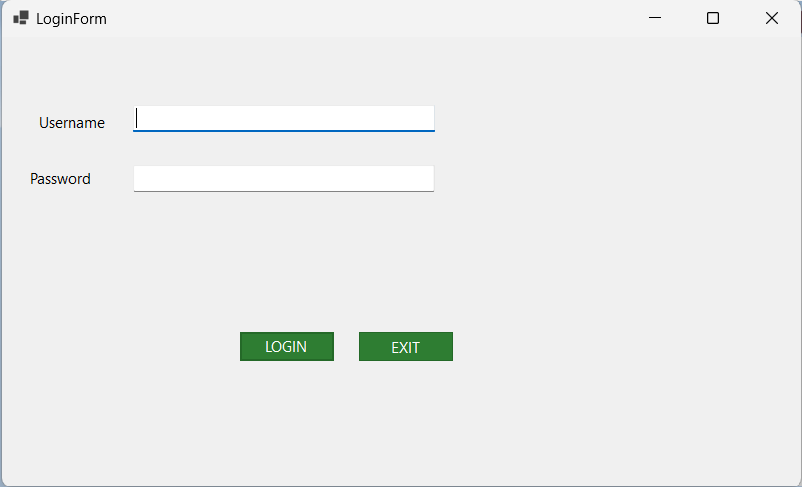 |
| Main menu | 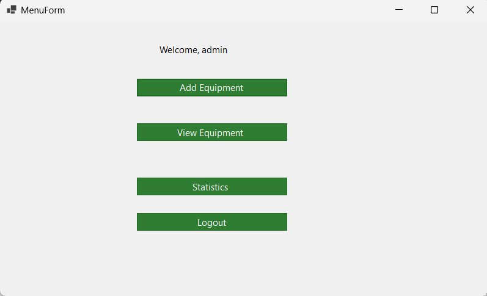 |
| Add equipment | 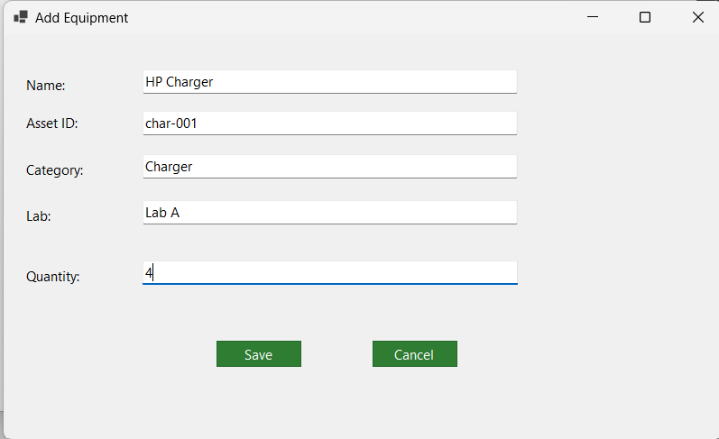 |
| Save confirmation | 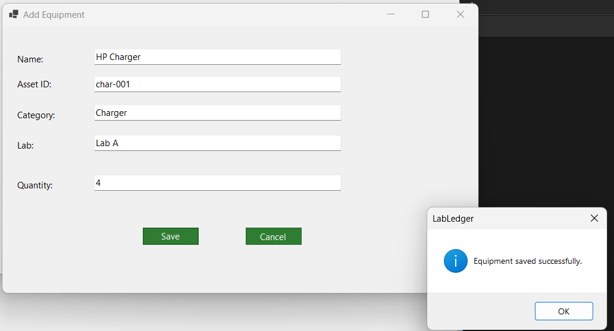 |
| Equipment inventory | 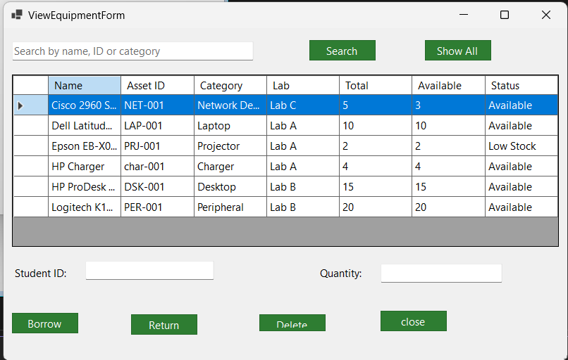 |
| Borrow form | 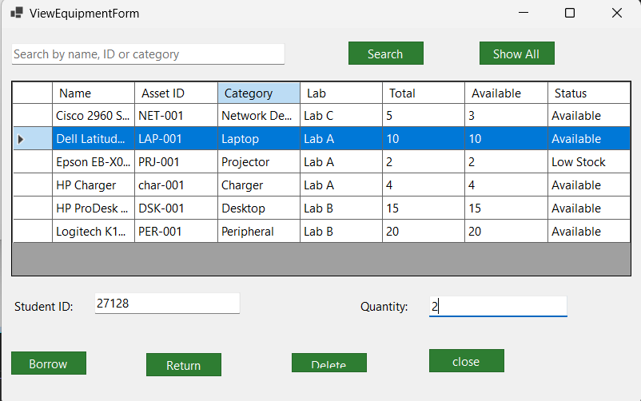 |
| Borrow confirmation | 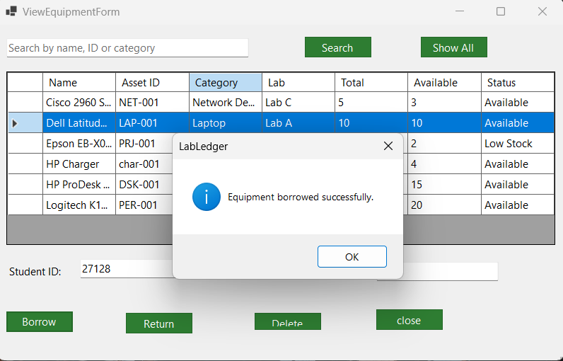 |
| Updated stock and delete confirmation | 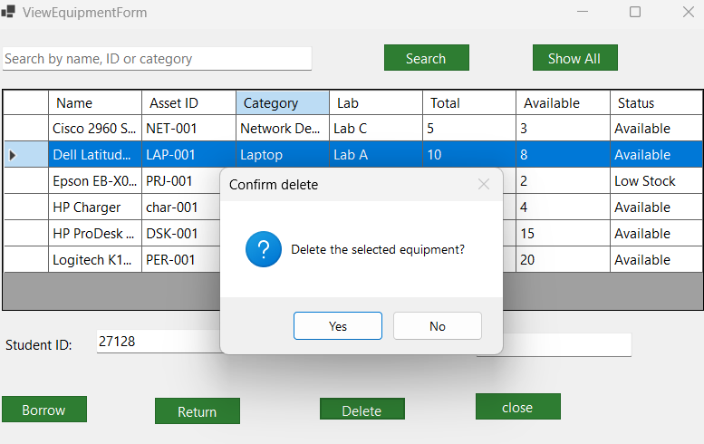 |
| Statistics | 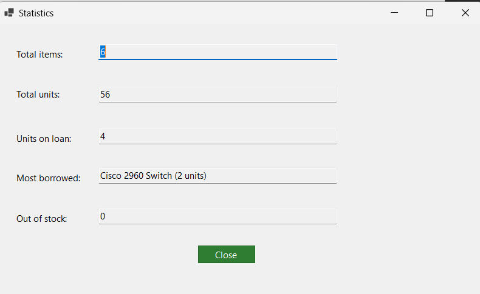 |
| MariaDB database in phpMyAdmin | 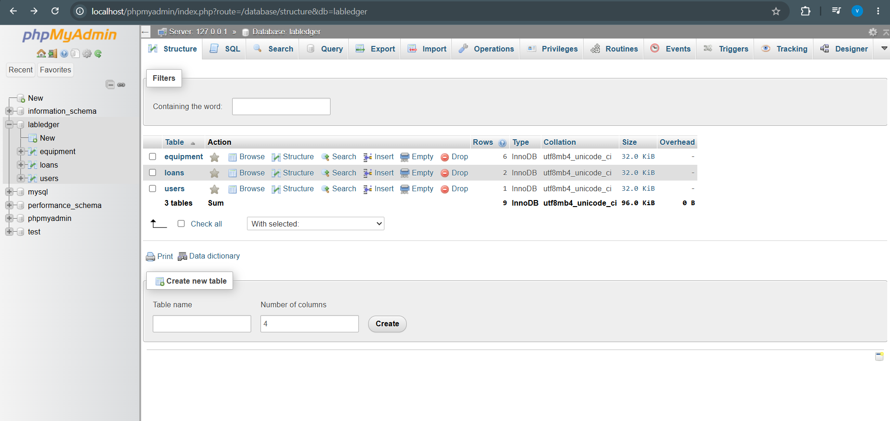 |
| Logout confirmation | 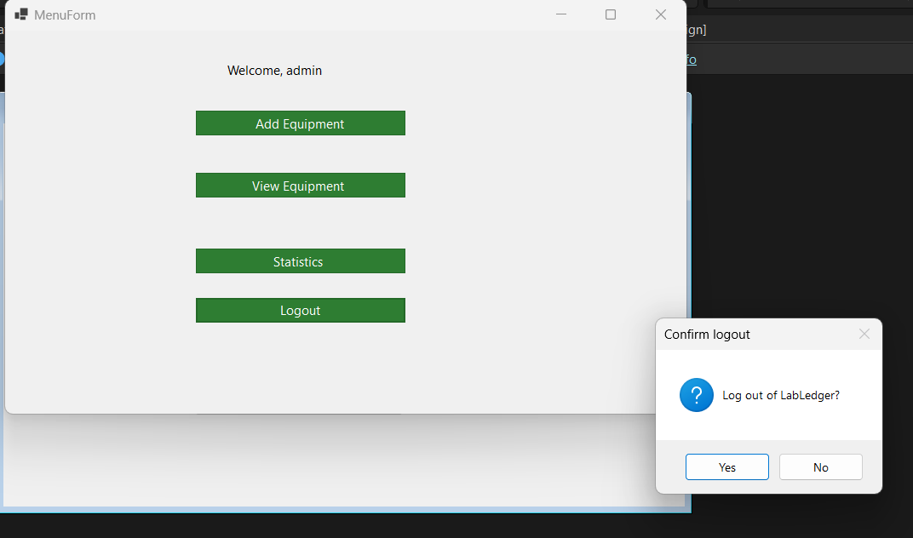 |

## Project layout

```text
LabLedger/
├── Controllers/   Validation and application operations
├── Data/          Database initialization and repositories
├── Models/        Equipment, loan, user, and result models
└── Views/         Windows Forms screens and shared button theme
docs/
└── screenshots/   README evidence images
```

## Data and account notes

- The database name is `labledger`.
- Passwords are stored as salted SHA-256 hashes, not as plain text.
- Equipment and loan records remain in MariaDB when the application closes.
- Back up the `labledger` database to preserve inventory and loan history.
